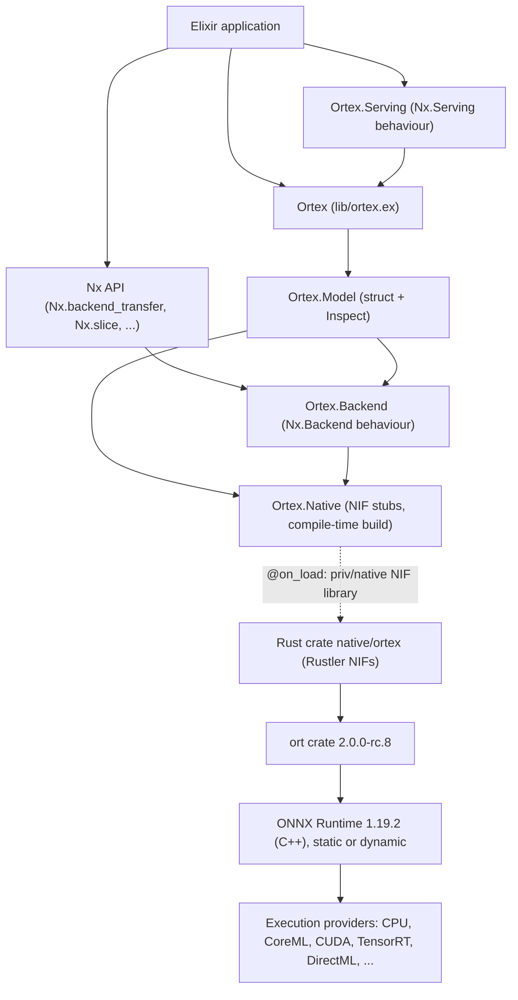
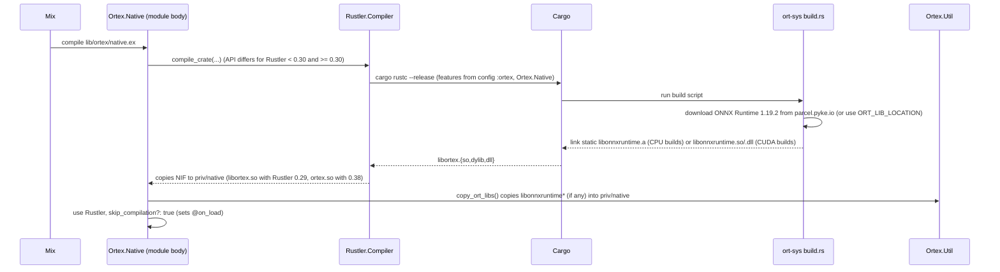

# Ortex architecture

Snapshot: `main` at `55dc3de` (2026-02-10), Hex release `0.1.10`. Everything below describes the
code as it is on `main` unless a section says otherwise. Planned changes live in
[`../TODO.md`](../TODO.md); upgrade work is described in [`upgrading.md`](upgrading.md).

## 1. What Ortex is

Ortex lets Elixir programs run ONNX models. It has three jobs:

1. Load an `.onnx` file into an ONNX Runtime *session* and keep it alive inside the BEAM.
2. Move tensor data between [Nx](https://hexdocs.pm/nx) and ONNX Runtime and run inference.
3. Plug into `Nx.Serving` so a model can be batched and served from a supervision tree.

It does not compile or train models and it does not implement Nx math. `Ortex.Backend` is a
*storage* backend: it holds tensors that came out of (or are about to go into) ONNX Runtime and
supports a handful of shape operations.

## 2. Layers



| Layer | Files | Language |
| --- | --- | --- |
| Public API | `lib/ortex.ex`, `lib/ortex/model.ex`, `lib/ortex/serving.ex`, `lib/ortex/backend.ex` | Elixir |
| NIF boundary (Elixir side) | `lib/ortex/native.ex`, `lib/ortex/util.ex` | Elixir |
| NIF boundary (Rust side) | `native/ortex/src/lib.rs` | Rust |
| Native domain | `native/ortex/src/{model,tensor,utils,constants}.rs` | Rust |
| Inference engine | `ort` crate (Rust bindings) + ONNX Runtime (C++ library downloaded at build time) | Rust/C++ |

Naming used in all docs: **`ort`** is the Rust crate by pyke (`pykeio/ort`); **ONNX Runtime**
(sometimes "ORT") is Microsoft's C++ engine that `ort` binds to. They have unrelated version
numbers: `ort 2.0.0-rc.8` bundles ONNX Runtime `1.19.2`.

## 3. Components, responsibilities, collaborators

The project follows Responsibility-Driven Design: each component owns its data and behaviour,
and collaborators ask it to act instead of reaching into its state. This table records what each
component knows and does today. Section 9 lists where today's code breaks that rule.

### Elixir

| Component | Knows | Does | Collaborators |
| --- | --- | --- | --- |
| `Ortex` | nothing (facade) | Delegates `load/3` and `run/2` to `Ortex.Model` | `Ortex.Model` |
| `Ortex.Model` | The NIF resource reference of one loaded session (`%Ortex.Model{reference: ref}`) | Loads a model (raises on `{:error, msg}`); runs inference: transfers inputs to `Ortex.Backend`, calls the NIF, wraps outputs as `Nx.Tensor`s; renders itself in `inspect` | `Ortex.Native`, `Ortex.Backend`, `Nx` |
| `Ortex.Backend` | The NIF resource reference of one tensor (`%Ortex.Backend{ref: ref}`) | Implements 9 `Nx.Backend` callbacks (`init`, `from_binary`, `to_binary`, `backend_transfer`, `inspect`, `slice`, `reshape`, `squeeze`, `concatenate`); every other callback is generated at compile time to raise `"operation X is not yet supported on Ortex.Backend."` | `Ortex.Native`, `Nx` |
| `Ortex.Serving` | The model closure | `Nx.Serving` callbacks: `init/3` builds `fn x -> Ortex.run(model, x) end`; `handle_batch/3` materialises the `Nx.Batch` with `Nx.Defn.jit_apply(&Function.identity/1, [batch])` and runs it | `Ortex`, `Nx.Serving`, `Nx.Defn` |
| `Ortex.Native` | NIF function names and arities | At **compile time**: builds the Rust crate (`Rustler.Compiler.compile_crate`), calls `Ortex.Util.copy_ort_libs/0`, then `use Rustler, skip_compilation?: true`. At **load time**: `@on_load` loads `priv/native/libortex.so`. Defines `:erlang.nif_error(:nif_not_loaded)` stubs | Rustler, cargo, `Ortex.Util` |
| `Ortex.Util` | Where cargo leaves `libonnxruntime*` files (`_build/<env>/lib/ortex/native/ortex/{release,debug}`) and their per-OS file names | Copies those files into `priv/native` so the NIF's rpath (`$ORIGIN`, `@loader_path`) finds them | file system |
| `Inspect` for `Ortex.Model` | nothing | Calls `Ortex.Native.show_session/1` and pretty-prints `{name, type_string, dims}` lists | `Ortex.Native` |

### Rust (`native/ortex/src`)

| Component | Knows | Does | Collaborators |
| --- | --- | --- | --- |
| `lib.rs` | The NIF table and each NIF's scheduler | Decodes BEAM terms, calls domain functions, encodes results or `{:error, String}`; registers the two resource types in the `load` callback | `model`, `tensor`, `utils`, Rustler |
| `model.rs` (`OrtexModel`) | One `ort::Session` | `init`: builds the session (optimisation level, execution providers, file path). `show`: lists inputs/outputs. `run`: converts inputs, runs the session, converts outputs | `ort`, `tensor`, `utils` |
| `tensor.rs` (`OrtexTensor`) | One owned `ndarray::ArrayD<T>` per dtype variant (`s8..s64`, `u8..u64`, `f16`, `bf16`, `f32`, `f64`, internal `bool`) | Shape, dtype, raw bytes, slice, reshape, concatenate, u8-to-bool conversion, conversions to and from `ort` values | `ndarray`, `half`, `ort` |
| `utils.rs` | The dtype string/bit-width table for decoding Nx binaries; the atom-to-execution-provider table; the int-to-optimisation-level table | `from_binary`, `to_binary`, `map_eps`, `map_opt_level`, `is_bool_input` | `tensor`, `constants`, `ort` |
| `constants.rs` | Execution-provider name strings and the `rustler::atoms!` list | (data only) | |

## 4. Key flows

### 4.1 Build (happens inside `mix compile`)



Details, platform matrix and environment variables: [`build-and-packaging.md`](build-and-packaging.md).

### 4.2 Load

`Ortex.load(path, eps \\ [:cpu], opt \\ 3)`
→ `Ortex.Model.load/3`
→ `Ortex.Native.init(path, eps, opt)` (dirty IO scheduler)
→ `utils::map_eps` turns atoms into `ExecutionProviderDispatch` values (unknown atoms silently become CPU)
→ `model::init` builds `Session::builder()?.with_optimization_level(..)?.with_execution_providers(eps)?.commit_from_file(path)?`
→ returns `ResourceArc<OrtexModel>`; Elixir wraps it in `%Ortex.Model{reference: ref}`.
Errors come back as `{:error, message}` and `Ortex.Model.load/3` raises `RuntimeError` with the message.

### 4.3 Run

```mermaid
sequenceDiagram
    participant Caller
    participant Model as Ortex.Model.run/2
    participant Backend as Ortex.Backend
    participant NIF as Ortex.Native (Rust)
    participant ORT as ONNX Runtime
    Caller->>Model: run(model, {t1, t2})
    Model->>Backend: Nx.backend_transfer(t, Ortex.Backend) per input
    Backend->>NIF: from_binary(binary, shape, type) (dirty CPU, copy 1)
    NIF-->>Backend: ResourceArc<OrtexTensor>
    Model->>NIF: run(model_ref, [tensor_refs]) (dirty IO)
    NIF->>NIF: zip inputs with session inputs by position, u8 to bool where the model wants bool
    NIF->>NIF: clone each ndarray into an ort Value (copy 2)
    NIF->>ORT: session.run(inputs)
    ORT-->>NIF: outputs (ONNX Runtime-owned memory)
    NIF->>NIF: try_extract_tensor + into_owned per output (copy 3); bool outputs become u8
    NIF-->>Model: [{tensor_ref, shape, dtype_atom, bits}] in model output order
    Model-->>Caller: tuple of Nx.Tensor with data %Ortex.Backend{ref: ...}
```

Inputs are matched to model inputs **by position**. Extra inputs are silently dropped by `zip`;
missing inputs fail inside ONNX Runtime with an unhelpful kernel error (verified, see
[`testing-and-ci.md`](testing-and-ci.md#4-behaviour-probe-results)). All model outputs are always
computed and returned.

### 4.4 Getting data back to Elixir

`Nx.backend_transfer(t)` → `Ortex.Backend.backend_transfer/3` → `Ortex.Native.to_binary(ref, 0, 0)`
returns a **resource binary** created with `ResourceArc::make_binary`: the BEAM binary points
straight at the tensor's memory (no copy) and keeps the `OrtexTensor` alive for as long as the
binary, or any sub-binary of it, is referenced. `Nx.BinaryBackend.from_binary/3` stores that
binary as-is.

### 4.5 Serving

`Nx.Serving.new(Ortex.Serving, model)` → `init/3` returns a closure over the model.
`handle_batch/3` turns the `Nx.Batch` into a tensor tuple by running
`Nx.Defn.jit_apply(&Function.identity/1, [batch])` (stacking happens on the default backend,
normally `Nx.BinaryBackend`), then calls `Ortex.run/2` inside the serving process and returns
`{:execute, fn -> {output, :server_info} end, state}`. `init/3` pattern-matches exactly one
partition (`[_defn_options]`), so `partitions: true` with more than one partition crashes.

## 5. Memory and lifetimes

* Both NIF resources (`OrtexModel`, `OrtexTensor`) are reference counted by the BEAM and freed
  when the last Elixir reference (term or resource binary) is garbage collected.
* The BEAM only sees a small reference term for a resource, not the megabytes behind it. A
  process that creates many large tensors without growing its own heap may not garbage collect
  for a long time, so native memory can climb. This is the usual first suspect for reports like
  issue #44 ("Memory leak"). Resource binaries returned by `to_binary` *are* counted as off-heap
  binary memory, so they trigger GC normally.
* Copies per `Ortex.run/2` today: one copy into Rust when an input comes from another backend,
  one clone into an `ort` value for every input (three for bool inputs), and one copy out of
  ONNX Runtime for every output. Section 4.4's transfer back to Elixir is zero-copy.
* Every `OrtexTensor` array must be in standard (row-major, contiguous) layout because
  `to_bytes` reinterprets the array's memory as a byte slice. Every code path that creates an
  array today produces standard layout (`concatenate` rebuilds explicitly). Keep it that way.
* Tensors are immutable once created. Nothing may mutate an `OrtexTensor` in place, because
  resource binaries alias its memory.

## 6. Concurrency and scheduling

| NIF | Scheduler | Notes |
| --- | --- | --- |
| `init/3` | dirty IO | Reads the file and optimises the graph. |
| `run/2` | dirty IO | Blocks while ONNX Runtime's own thread pool computes. |
| `from_binary/3`, `to_binary/3` | dirty CPU | Copies or aliases tensor memory. |
| `show_session/1` | normal | Cheap metadata read. |
| `slice/4`, `reshape/2`, `concatenate/3` | normal | **Copy whole arrays**; large tensors can exceed the 1 ms budget of a normal scheduler. Should be dirty CPU. |

* One `OrtexModel` is shared by every process that holds the `%Ortex.Model{}`. With
  `ort 2.0.0-rc.8`, `Session::run` takes `&self`, ONNX Runtime's `Run` is thread safe, and the
  crate adds `unsafe impl Sync for OrtexModel {}`. Concurrent `Ortex.run/2` calls on one model
  run in parallel (verified with 32 concurrent tasks).
* That parallelism is only safe on some providers. `ort`'s maintainers made `Session::run` take
  `&mut self` (rc.10+) because concurrent inference on one session "often saw crashes and memory
  corruption", and ONNX Runtime forbids concurrent `Run()` on one session with DirectML and CUDA
  graphs. Open PR #47 answers that with a `Mutex<Session>`, which serialises inference per model; see
  [`upgrading.md`](upgrading.md) section 3.3 for the options (mutex, session pool, per-partition
  sessions).
* After the upgrade there is exactly one ONNX Runtime `Environment` per OS process (a second
  `ort::init().build()` fails), owned by the NIF and shared by every session.
* Each session gets its own ONNX Runtime intra-op thread pool sized to the machine by default (with
  busy-wait spinning on in rc.8; pyke's builds from rc.11 turn spinning off by default). Loading
  several models therefore creates several pools that compete with each other and with BEAM
  schedulers. Ortex exposes no thread or spinning settings today (open PRs #50, #51, #52); after the
  upgrade a process-wide global thread pool becomes possible.

## 7. Error model

| Source | What the caller sees |
| --- | --- |
| `ort`/ONNX Runtime error, invalid shape, wrong dtype, missing file | NIF returns `{:error, message}` (`rustler::Error::Term`). `Ortex.Model` and `Ortex.Backend.from_binary/to_binary` raise `RuntimeError, message`. |
| `{:error, _}` from `slice`, `reshape`, `concatenate` | **Not checked** by `Ortex.Backend` on `main`; the error tuple would be stored as the tensor's `ref`. |
| Term decoding failure (wrong argument type, e.g. a string execution provider or a tensor start index in `Nx.slice`) | `ArgumentError` ("argument error"). |
| Rust panic (`unimplemented!`, `todo!`, `panic!`, `unwrap`) | Rustler catches it: `ErlangError` with reason `:nif_panicked`, plus a panic message on stderr. The VM keeps running. |
| Unsupported Nx operation on an Ortex tensor | `RuntimeError, "operation <name> is not yet supported on Ortex.Backend."` |

## 8. Invariants (keep these true)

1. The set of NIFs is declared three times and must match: `#[rustler::nif]` functions in
   `lib.rs`, the list in `rustler::init!` (required by Rustler 0.29), and the stub functions in
   `lib/ortex/native.ex` (same names and arities).
2. `OrtexTensor` arrays are in standard layout and never mutated after creation (section 5).
3. The bool variant never escapes to Elixir. Nx has no boolean type: ONNX `bool` outputs become
   `{:u, 8}` and `{:u, 8}` inputs are converted to bool only when the model input is bool
   (values must be 0 or 1).
4. Anything that may take longer than about 1 ms runs on a dirty scheduler.
5. NIF code paths reachable with user data must return errors, not panic.
6. Output order equals `session.outputs` order; input order equals `session.inputs` order.

## 9. Responsibility problems in today's code

Each item names the component that should own the knowledge; the fixes are tracked in
`TODO.md` (section "Architecture and API").

1. **`Ortex.Model` builds and takes apart `Ortex.Backend` data.** `Model.run/2` pattern-matches
   `%Nx.Tensor{data: %Ortex.Backend{ref: x}}` and constructs `%Nx.Tensor{data: %Ortex.Backend{...}}`
   by hand. The backend should own that: e.g. `Ortex.Backend.to_ref/1` and
   `Ortex.Backend.wrap(ref, shape, type)`.
2. **`Ortex.Util.copy_ort_libs/0` mirrors the build system.** It hard-codes Rustler's target
   directory layout, cargo profile folders, `ort`'s download behaviour and per-OS library names.
   It is already broken for most users: Hex resolves `{:rustler, "~> 0.27"}` to Rustler 0.38, which
   builds into `deps/ortex/native/ortex/target/release/` (verified), while the function only looks in
   `_build/<env>/lib/ortex/native/ortex/{release,debug}` (the Rustler 0.29 layout). It also misses
   Windows (`onnxruntime.dll` has no `lib` prefix). The build should produce a self-contained NIF
   (static linking, or the native build placing its own side libraries) so Elixir needs no
   knowledge of it.
3. **Execution-provider knowledge is spread across five places**: `config/config.exs` (which
   Cargo features per OS), `Cargo.toml` features, `constants.rs`, `utils::map_eps` (with a silent
   CPU fallback), and the docs. Elixir cannot ask what was compiled in or is usable. The native
   layer should own the catalogue and answer `available_execution_providers/0`, and loading
   should fail (or warn) when a requested provider is unavailable.
4. **Elixir tells Rust facts the tensor already knows.** `concatenate/3` receives the output
   type and `to_binary/3` receives the element bit width from Elixir, although every
   `OrtexTensor` knows its dtype. Rust should derive them (and validate that concatenated inputs
   agree); Elixir should pass only what it owns (axis, element limit).
5. **Model metadata leaks `ort`'s `Debug` format.** `model::show` returns
   `format!("{:#?}", value_type)`, so the public `inspect` output changes whenever `ort` changes
   its `Debug` impl (it already did: the README promises `"Float32"` and `nil` dimensions; the
   code prints a multi-line `Tensor { ty: Float32, dimensions: [-1, ...] }` and `-1`). Rust
   should return structured data (name, Nx type, dimensions with `nil` for dynamic axes,
   symbolic dimension names); Elixir should format it.
6. **No single owner of the NIF error contract.** Some callers raise on `{:error, _}`, some
   ignore it, some get `ArgumentError` from decoding. One Elixir module (the native boundary)
   should own conversion of native results into `{:ok, _} | {:error, %Ortex.Error{}}`, and the
   public functions should decide whether to raise.

## 10. Design decisions and their reasons

| Decision | Reason | Revisit when |
| --- | --- | --- |
| Storage-only `Nx.Backend` | ONNX Runtime does the math; tensors only need to cross the boundary and be reshaped/sliced for batching. | Never for math; implement the remaining *data movement* callbacks (`backend_copy`, `backend_deallocate`, `as_type`, `to_batched`). |
| Build the crate manually before `use Rustler` | `ort` downloads ONNX Runtime during cargo build; the side libraries must be copied into `priv/native` before the NIF is loaded, which `use Rustler` alone did not allow. | Static linking everywhere, or precompiled NIFs (PR #49). |
| Positional inputs, all outputs | Simple tuple API mirroring `Nx.Serving` containers. | Named inputs/outputs are a common request; see TODO. |
| Bool as `u8` | Nx has no boolean type; Nx predicates return `u8`. | If Nx adds a boolean type. |
| `run` on dirty IO | ONNX Runtime does the CPU work on its own intra-op threads while the calling BEAM thread mostly waits; the dirty IO pool (10 threads by default) is separate from the dirty CPU pool, so long inferences do not starve other CPU-bound NIFs. | If `run` becomes CPU-bound on the calling thread (e.g. intra-op threads set to 1), switch to dirty CPU. |
| Execution providers chosen per OS in `config/config.exs` | Convenience for developing Ortex itself. | It does not apply to dependents at all (Mix does not load a dependency's config); see `build-and-packaging.md`. |
